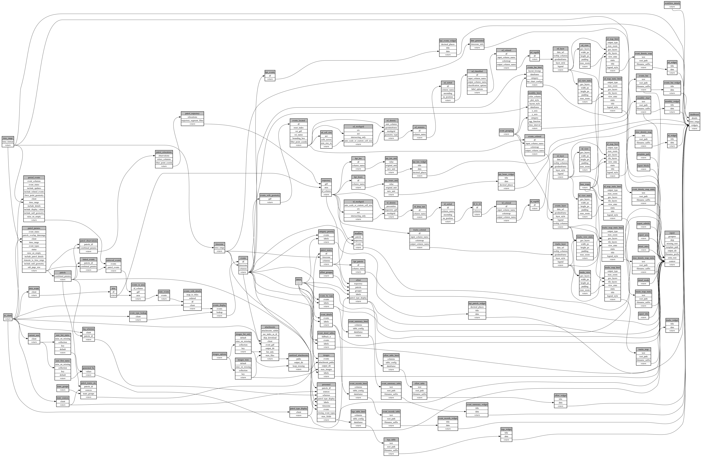

```
# AUTOGENERATED BY ECOSCOPE-WORKFLOWS; see fingerprint in README.md for details

```

```yaml
# fingerprint:
artifacts_sha256_basic: 318f207bd41339c446161e5ad5cb217518c95649a35e6b70685f61fcf92c5ed6
artifacts_sha256_strict: 3ca64765f99f3ae79308470a78fd31aa143bc3ab6d877bbeaf0d72e259e1c4dd
installed_requirements:
- channel: https://repo.prefix.dev/ecoscope-workflows/
  name: ecoscope-platform
  version: {version: ==2.28.0}
- channel: file:///tmp/ecoscope-workflows-custom/release/artifacts/
  name: ecoscope-workflows-ext-custom
  version: {version: ==0.1.6.dev31+g60e7cc9a3}
- channel: file:///tmp/ecoscope-workflows-custom/release/artifacts/
  name: ecoscope-workflows-ext-standard-patrol-events
  version: {version: ==10000.dev15+gb457cea4b.d20261118}
- channel: conda-forge
  name: pydeck
  version: {version: ==0.9.2}
params_sha256: dbed3aa174fce735dc1618490a0379564b3e08011982daf78e8af102a8bb40d5
spec_sha256: ca889f9e316a18ebe2b55deccddc3695624afaba84d8cfea3bc26bb3fe3dca31

```

# ecoscope-workflows-standard-patrol-events-workflow


